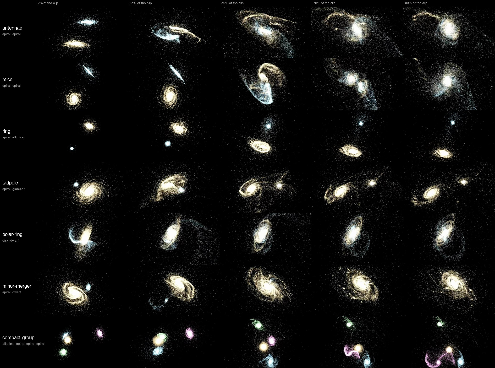

# Sillage

Galaxy collisions, simulated and filmed on an Apple Silicon Mac: a Barnes-Hut N-body solver
that builds and walks its tree on the GPU, and a renderer for tens of millions of particles.

https://github.com/user-attachments/assets/325910ab-a244-47e4-a323-6c62412da79a

*Two spiral galaxies meet, fling out two long tidal tails and merge into one over about a
billion years: 32 million particles, 3 million of them carrying the mass.*

The aim is a beautiful render that stays honest about the physics: the models come from the
standard literature, and the limits are listed below.

## From a scene to a video

1. **Set up or generate.** Place galaxies by hand on the setup screen, or let the generator
   draw encounters, among them archetypes such as the Antennae, the Mice, a ring, a polar
   ring and a compact group.
2. **Preview.** Every scene is explored as a short clip, scored, and shown in the library,
   where you keep it or discard it.
3. **High resolution.** The scenes you keep run again at millions of particles, overnight if
   needed.
4. **Style.** Dozens of looks, from Hubble and Webb palettes to free ones, with a fixed
   camera or a director.
5. **Export.** Videos and looping animations, with the scene and look files kept beside each
   render so any of them can be replayed.



*Seven archetypes at five moments of their clip: the Antennae, the Mice, a ring, a tadpole, a
polar ring, a minor merger and a compact group.*

## Getting started

macOS 14 or later on an Apple Silicon Mac.

```bash
git clone https://github.com/pierregc/sillage.git
cd sillage
./scripts/dev.sh app && open .build/dev/Sillage.app
```

The same script runs the tests, the headless renderer and the night pipeline; Xcode is not
needed.

## How it works

Two solvers share one scene: a restricted one that moves test particles through rigid
potentials, after Toomre and Toomre (1972), and a Barnes-Hut one that gives the particles
mass, dark-matter halos included, with a tree built in Morton order and walked on the GPU.
Both integrate with leapfrog, and the softening and the step are derived from the scene.
Units: kpc, 10^10 solar masses, G = 1.

## Known limits

- No gas, no pressure, no shocks.
- Hand-made colours, not real bands.
- A fixed time step.
- Single precision.
- Not compared against a published simulation.
- Apple Silicon only.

## Documentation

- [Reference](docs/reference.md): every command, flag, file and format.
- [Night Manager](docs/night-manager.md): the user guide.
- [Working notes](docs/notes/README.md): what was tried, what was measured, and why.

## About

One maintainer, several AI agents, no roadmap. Issues are welcome and answered when there is time.

The physics follows Toomre and Toomre (1972) for the
restricted solver, Barnes and Hut (1986) for the tree, Freeman (1970) for the disk and
Toomre (1964) for its stability.

Code: MIT. Renders and videos: [CC BY 4.0](https://creativecommons.org/licenses/by/4.0/),
so reuse them freely as long as the credit comes along.
