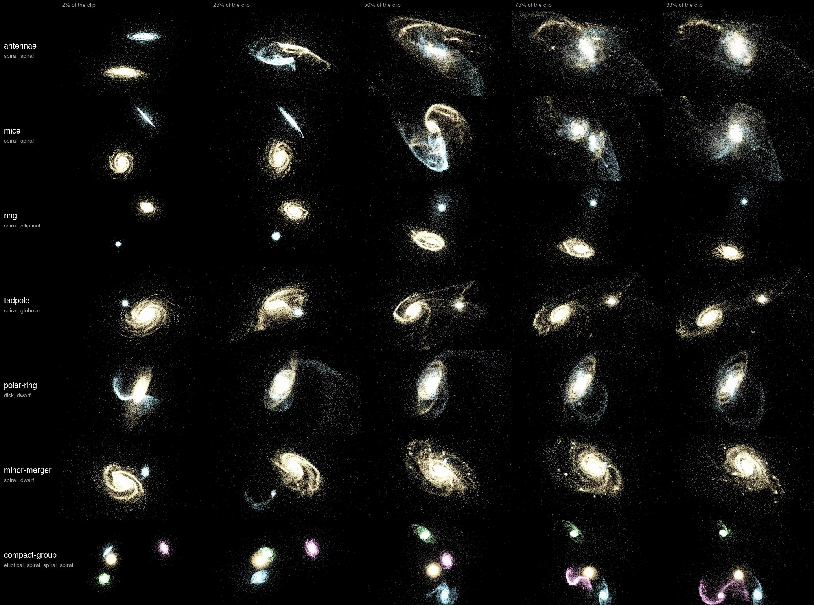

# Sillage

Galaxy collisions, simulated and filmed on the GPU, on Apple Silicon (Metal) and on NVIDIA
(CUDA, under Linux): a Barnes-Hut N-body solver that builds and walks its tree on the GPU, and a
renderer for tens of millions of particles. The Mac is where scenes are set up, explored and
styled; a rented NVIDIA GPU computes them faster. On a scene of 8 million visible particles and
12 million of dark matter, a solver step takes 128 ms on an RTX 5090 against 450 ms on an M4 Max
([measured](docs/notes/cuda-engine.md#timed-on-an-rtx-5090-424)).

https://github.com/user-attachments/assets/14fa1b7f-b199-45be-9f6f-948f880c3c61

*Two spiral galaxies meet, fling out two long tidal tails and merge into one over about a
billion years: 8 million stars, each carrying its mass, inside 12 million particles of dark
matter.*

The aim is a beautiful render that stays honest about the physics: the models come from the
standard literature, and the limits are listed below.

## From a scene to a video

1. **Set up or generate.** Place galaxies by hand on the setup screen, or let the generator
   draw encounters, among them archetypes such as the Antennae, the Mice, a ring, a polar
   ring and a compact group.
2. **Preview.** Every scene is explored as a short clip, scored, and shown in the library,
   where you keep it or discard it.
3. **High resolution.** The scenes you keep run again at millions of particles, overnight if
   needed.
4. **Style.** Dozens of looks, from Hubble and Webb palettes to free ones, with a fixed
   camera or a director.
5. **Export.** Videos and looping animations, with the scene and look files kept beside each
   render so any of them can be replayed.



*Seven archetypes at five moments of their clip: the Antennae, the Mice, a ring, a tadpole, a
polar ring, a minor merger and a compact group.*

## Two engines

| | Apple Silicon (Metal) | NVIDIA (CUDA, Linux) |
| --- | --- | --- |
| App, setup and library screens | yes | no |
| Preview (`explore`) | yes | yes, `sillage-cuda explore` |
| High resolution pass and take | yes | yes, `sillage-cuda hires` |
| Video and flight export | yes | yes, `sillage-cuda export` |
| Stills, black hole close up | yes | yes |
| Text overlays, animated previews, "visual" pacing | yes | no |

Both engines run the same kernel source and the same Swift orchestration, and are checked
against each other ([one kernel source](docs/notes/one-kernel-source.md)). A scene goes from
one to the other as files. The CUDA engine has run on rented RTX 3090 and RTX 5090 cards
([first run](docs/notes/cuda-bring-up.md), [how work reaches a box](docs/notes/cuda-platform.md)).

## Getting started

The app: macOS 14 or later on an Apple Silicon Mac. The CUDA engine: Linux with an NVIDIA GPU
(CUDA 12.8 or later), see [the CUDA engine](docs/notes/cuda-engine.md).

```bash
git clone https://github.com/pierregc/sillage.git
cd sillage
./scripts/dev.sh app && open .build/dev/Sillage.app
```

The same script runs the tests, the headless renderer and the night pipeline; Xcode is not
needed.

## How it works

Two solvers share one scene: a restricted one that moves test particles through rigid
potentials, after Toomre and Toomre (1972), and a Barnes-Hut one that gives the particles
mass, dark-matter halos included, with a tree built in Morton order and walked on the GPU.
Both integrate with leapfrog, and the softening and the step are derived from the scene.
Units: kpc, 10^10 solar masses, G = 1.

## Known limits

- No gas, no pressure, no shocks.
- Hand-made colours, not real bands.
- A fixed time step.
- Single precision.
- Not compared against a published simulation.
- The app and its screens run on Apple Silicon only; the CUDA engine is a command line.

## Documentation

- [Reference](docs/reference.md): every command, flag, file and format.
- [Night Manager](docs/night-manager.md): the user guide.
- [Driving Sillage as an agent](AGENTS.md): one recipe per common task, for an AI that runs the commands.
- [Working notes](docs/notes/README.md): what was tried, what was measured, and why.

## About

One maintainer, several AI agents, no roadmap. Issues are welcome and answered when there is time.

The physics follows Toomre and Toomre (1972) for the
restricted solver, Barnes and Hut (1986) for the tree, Freeman (1970) for the disk and
Toomre (1964) for its stability.

Code: MIT. Renders and videos: [CC BY 4.0](https://creativecommons.org/licenses/by/4.0/),
so reuse them freely as long as the credit comes along.

To cite the software, see [CITATION.cff](CITATION.cff).
