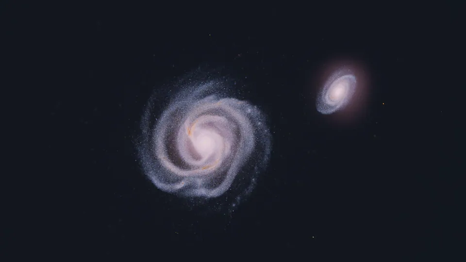

# Sillage

A hobby N-body simulator for galaxy collisions on Apple Silicon. The models are taken from the
standard literature, and what they are pointed at is a picture worth looking at rather than a
research result.



## Running it

macOS 14 or later on an Apple Silicon Mac.

```bash
git clone https://github.com/pierregc/sillage.git
cd sillage
./scripts/dev.sh app && open .build/dev/Sillage.app
```

The app opens on a setup screen: add galaxies, set their masses, radii, inclinations and spins,
then start the run. Drag to orbit, scroll to zoom, `F` to fly, space to pause. Presets are
`encounter`, `merger`, `flyby` and `disk`.

`./scripts/dev.sh test` runs the suite, and `./scripts/dev.sh render` writes an image sequence
without opening a window, which is how the animation above was made. Everything goes through
that script rather than SwiftPM: with only the Command Line Tools installed, no manifest will
compile. Shaders are built at runtime, so Xcode is not needed either way.

Every render writes a scene file beside its output, `x.png` or `x.mov` giving `x.scene.json`
(`--scene-out` picks another path). It holds the physics and nothing else: the seed, the
encounter, each galaxy's parameters and its share of the particles, but no colour and no
particle count. `./scripts/dev.sh render --scene x.scene.json --particles 5000000` replays the
same scene at any size; flags given alongside it override the file.

A look file sits beside it, `x.look.json` (`--look-out` for another path), holding everything
that decides the image and nothing that decides the physics: the render settings, the colour
of each galaxy, and the camera, fixed or left to the director. `--look x.look.json` draws with
it, and every look flag given alongside overrides its field. A field left out takes the value
`sillage-render` uses with no flags, so a file names only what it changes. The two files
together replay a render exactly. `looks/raw.look.json` is plain points with no effects.

A generated scene draws its physics and its colours from two separate streams of the seed.
`--look-seed N` repaints `--preset contemplation --seed S` with another palette and leaves
every physical parameter where it was. Scenes drawn before the split keep their physics;
`--look-seed S`, the seed itself, gives them back their old colours too.

An encounter is described by its geometry rather than by where the galaxies start: the
pericentre distance, the eccentricity (below one bound, one parabolic, above one hyperbolic,
judged against the potential the two galaxies really exert there), the mass ratio, when the
pericentre falls, each disk's inclination and line of nodes against the orbital plane with its
spin, and where that plane lies. The scene file keeps them under `encounters`, next to the
positions and velocities they gave, which are what a replay runs from. Those are worked out
backwards: each secondary is set at its pericentre beside where its primary actually is at that
moment, then stepped back to the start through the galaxies already placed, every galaxy
pulling with the mass it holds inside the separation. The centres are then run forward together
and the passages asked for are corrected until they land. A generated scene puts its
pericentres inside the clip it is rendered for, between `--settle` and `--steps`.

## Scene folders

A scene goes through four stages, each one command that reads and writes the scene's own
folder, so moving it on or doing a stage again needs the folder and nothing else:

```
library/<batch>/
    index.csv              the batch: one row per scene
    ratings.json           yes, no and a rating per scene
    <scene>/
        scene.json         the physics
        look.json          the image
        clip.json          how long the clip runs and how large it is drawn
        preview.mov        the exploration clip
        thumbnail.png      one still from the middle of it, 480 px wide
        curves.csv         per frame separation, extent and stars formed
        take.sillage       the run at full size, for the later stages
        exports/           the finished videos
```

```bash
./scripts/dev.sh explore library/2026-10-23/scene-0001 --seed 42 --director
./scripts/dev.sh hires   library/2026-10-23/scene-0001 --particles 5000000
./scripts/dev.sh look    library/2026-10-23/scene-0001
./scripts/dev.sh export  library/2026-10-23/scene-0001
```

`explore` renders the preview, the thumbnail and the curves. In an empty folder it generates a
self-gravitating contemplation scene from the options given, `--seed` first among them; once
`scene.json`, `look.json` and `clip.json` are there it reads them back, so running it again
with no options gives the same clip, and any option given overrides the file it belongs to.
The clip's options are `--particles`, `--width`, `--height`, `--frames`, `--fps`, `--steps` and
`--settle`. To start a scene over, empty its folder. `hires` (#19), `look` (#22) and `export`
(#24) are not written yet and say so. The same stages are `sillage-render <stage> <folder>`.

### The library

The application's library window (⌘L, or **Bibliothèque** on the setup screen) shows every
scene under `library/`, both scene folders and the older flat batches, and picks up new
scenes as they are written. The grid shows stills; only the scene under the pointer, the
selected one or the enlarged one plays its clip. Under each scene, yes, no and a rating from
0 to 10, each saved in one click to the batch's `ratings.json`; clicking a lit button takes it
back. Keys: arrows to move, `Y` and `N`, digits for the rating (`1` then `0` for ten), delete
to clear, space to enlarge, escape to close. Sort by batch, rating or date, filter by choice,
rating, batch and archetype.

```json
{ "version": 1, "scenes": { "scene-0001": { "choice": "yes", "rating": 8, "updated": "2026-10-24T06:00:00Z" } } }
```

The scenes kept for the next stage are
`jq -r '.scenes | to_entries[] | select(.value.choice == "yes") | .key' ratings.json`.
`Sillage.app --librarycheck` drives the whole window model through a library it builds on disk.

## The physics

Two solvers share one scene description, one particle buffer and one renderer. **Restricted**
moves massless test particles through rigid analytic potentials, following Toomre and Toomre
(1972), at O(N); it raises the bridges and tails cheaply, which is useful while framing a shot.
**Barnes-Hut** gives the particles mass and a tree built in Morton order and traversed on the
GPU, at O(N log N). Dark halos become particles too, so an infalling companion
raises a wake that drags on it, and the disks grow their own bars and arms. The images above
use Barnes-Hut.

**Integrator.** Kick drift kick leapfrog in both solvers, at a fixed step. The step and the
force softening are derived from the scene rather than exposed: softening is 1.5 times the mean
interparticle spacing of the densest disk, capped at 1 kpc, and the step is short enough that a
particle crosses well under one softening length per step.

**Units.** Lengths in kpc, masses in 10^10 solar masses, G = 1. The derived velocity unit is
207.4 km/s and the time unit is 4.71 Myr.

**Parameters.** Per scene: particle count, opening angle, halo particle ratio. Per galaxy:
mass, scale radius, truncation, thickness, Toomre Q, inclination, position angle and spin.

### Known limits

- Single precision throughout: positions, velocities and forces are all 32 bit floats.
- No hydrodynamics. No gas, no pressure, no shocks. The dissipation time is a relaxation term
  standing in for the gas that keeps a real disk cool, not a fluid solver.
- Star formation decides how a region is drawn and nothing else. It never feeds back into the
  forces.
- The step is fixed for the whole run rather than adaptive, so a deep pericentre is integrated
  no more finely than the approach.
- In restricted mode the halos are rigid and follow their galaxy, which does work on the
  system, so the pair never actually merges. The suite checks that live halos conserve momentum
  considerably better.
- None of this has been compared against a published simulation. The tests check internal
  consistency, equilibrium and conservation, not agreement with anyone else's results.

## Layout

```
Sources/SillageCore/     physics, no rendering dependency
Sources/SillageRender/   Metal solver, splat renderer, camera
Sources/SillageApp/      SwiftUI setup screen and live view
Sources/sillage-render/  headless PNG renderer
```

## Small print

AI did a good share of the typing here. Seemed worth saying out loud.

## License

Code: MIT. Renders and videos: [CC BY 4.0](https://creativecommons.org/licenses/by/4.0/),
so reuse them freely as long as the credit comes along.
