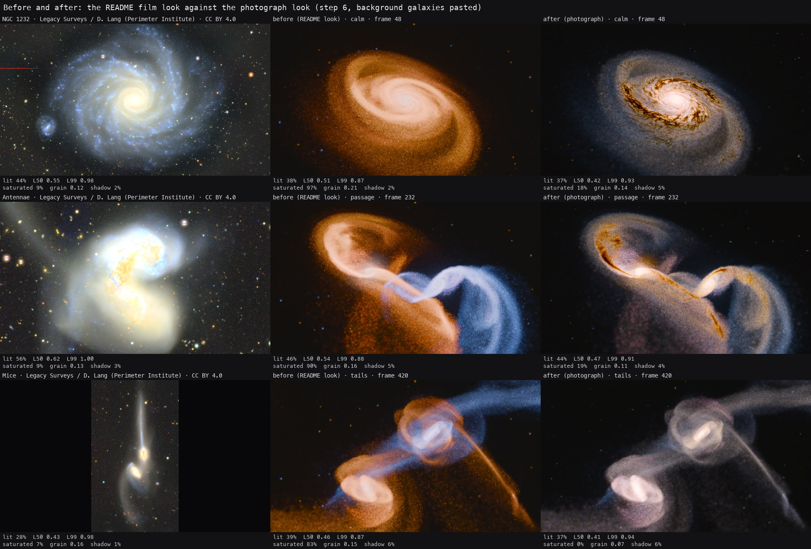

# A frame that passes for a photograph

#315 took the cues of [What would give Sillage its dimension](next-dimension.md) one at a time on
stills of a take that already exists: no new run, no new physics, no change in the particle count.
Each step was judged on a contact sheet against deep photographs and with a ruler, and the result
is a look, `looks/photograph.look.json`.

**In short.**

- **Settings get most of the way.** One colour scheme for every galaxy (gold core, cream body,
  pale blue edge), a core that reaches white, a smooth continuum under the arms and dust lanes
  that cut the light at the size of a galaxy. Saturated pixels fall from 90 to 97 % to 14 to
  16 % on the calm disk and the passage, against 7 to 9 % on the ground photographs and 14 % on
  Hubble's Antennae; the tails, where the run has used up the dust, keep almost none.
- **What settings cannot do** is in the young stars and the knots. Both are scattered evenly
  through the disks: as colours they tint the whole body, as compact sources they are sand, and
  no setting tells them from the old stars. A kernel width per population (measured with a
  throwaway change) gives the continuum; beads would need the young stars grouped.
- **The look does not carry over unchanged**: on the Antennae take the same settings stop the
  cores at L 0.85 to 0.87 and darken a disk seen nearer edge on with dust, and at 200 000
  particles the column smoothing turns into bokeh.
- **Auto would not pick it whole, but picks its settings.** With its one colour scheme it scores
  0.535 against 0.674 for Auto's pick on the Mice: the scores reward two colours. Once the look
  is in the catalogue, Auto takes its settings with a two-colour palette over Webb's, 0.719 on
  the Mice and 0.713 on the Antennae, so telescope nights would change with it.

## The board

The twelve Hubble and Webb images of [What Hubble and Webb pictures are made of](telescope-colour.md)
are the reference for colour, with their credits there. `scripts/telescope-colours.py fetch` now
gets a 403 from `cdn.esahubble.org` through Python's `urllib`; `curl` on the same URLs works.

An 8 M take has about the resolution of a deep photograph from the ground, so three of those are
the reference for light. They are cutouts of the DESI Legacy Imaging Surveys, CC BY 4.0, credit
**Legacy Surveys / D. Lang (Perimeter Institute)**, fetched into `out/ground-images/` (not
committed) from `https://www.legacysurvey.org/viewer/jpeg-cutout`:

| Image | Stands for | Cutout |
| --- | --- | --- |
| NGC 1232 | a calm disk | `ra=47.439&dec=-20.579&width=2400&height=1600&layer=ls-dr10&pixscale=0.3` |
| The Antennae, whole system and tails | the passage (bodies) and the tails | `ra=180.452&dec=-18.885&width=2400&height=2000&layer=ls-dr10&pixscale=0.66`, bodies `ra=180.472&dec=-18.878&width=1600&height=900&pixscale=0.262` |
| The Mice | the tails | `ra=191.543&dec=30.728&width=2400&height=1600&layer=ls-dr9&pixscale=0.262` |

M51 and NGC 7331 were tried and left out: the northern survey draws M51 in false cyan with missing
tiles, and NGC 7331 came back empty. The board with the ruler's numbers under each image
and every credit: [reference-board.jpg](https://github.com/pierregc/sillage/blob/e7d6a7c80f00c8111544de7921bb38535253623b/reference-board.jpg).

## The ruler

`scripts/photo-ruler.py <image>...` reads every image at 960 px wide (`--width` for another size,
`--overlays DIR` to see the masks) and gives six numbers:

- **lit**: share of the frame 0.10 in OKLab L above the sky, the sky being the 5th centile of L
  blurred at 4 px;
- **L50, L99**: L of the lit pixels at the median and the 99th centile;
- **saturated**: share of the lit pixels with an OKLab chroma above 0.05;
- **grain**: rms of the linear light finer than 1.5 px against the light at 8 px, over the
  galaxies' light only (lit pixels inside the light blurred at 16 px);
- **shadow**: share of the inside of the body darker than 0.65 of its surroundings at 24 px and
  yellower than them, as dust makes it.

The first numbers of the study note came out of a ruler held to JPEGs; this one gives on the same
side by side Hubble's Antennae 71 % lit, L 0.46 and 0.93, 17 % saturated against the note's 60 %,
0.51, 0.94 and 20 %. The grain matched the note's 0.44 (0.48) only when taken over every lit pixel,
and then a single field star outweighs a whole disk, so the grain here is taken over the galaxies:
Hubble's Antennae 0.22 to 0.25, the ground photographs 0.12 to 0.16. The shadow is the weakest of
the six: on a render without dust it still finds the gaps between arms (step 2 below reads 10 %
with no dust at all), so the sheets are the measurement for dust.

| Reference, 960 px | lit | L50 | L99 | saturated | grain | shadow |
| --- | --- | --- | --- | --- | --- | --- |
| Hubble, Antennae (heic0615a) | 56 % | 0.42 | 0.91 | 14 % | 0.22 | 5 % |
| Ground, NGC 1232 | 44 % | 0.55 | 0.98 | 9 % | 0.12 | 2 % |
| Ground, Antennae bodies | 56 % | 0.62 | 1.00 | 9 % | 0.13 | 3 % |
| Ground, the Mice | 28 % | 0.43 | 0.98 | 7 % | 0.16 | 1 % |

## The take and the moments

The README film's scene, the Mice (`youtube-4k/library/20261104/scene-0067`), its 8 M massive take,
with the film's camera angles (elevation 1.1, azimuth 0.467) and a fixed camera per moment framed
so the galaxies light about 40 % of the frame: a calm disk at frame 48 (335 Myr, the bigger galaxy
alone, radius 16.5 kpc), the first passage at frame 232 (481 Myr, 18 kpc apart, radius 19) and the
tails at frame 420 (629 Myr, near apocentre, radius 26). The take keeps one frame in four, so the
three are stored frames. Stills are drawn at 3840 px and reduced, as the film is.

"Before" is the film's look, `readme-v4`.

| Step, Mice take, calm / passage / tails | saturated | L50 | L99 | grain |
| --- | --- | --- | --- | --- |
| before (`readme-v4`) | 97 / 90 / 83 % | 0.51 / 0.54 / 0.46 | 0.87 / 0.88 / 0.87 | 0.21 / 0.16 / 0.15 |
| 1, one colour scheme | 0 / 2 / 1 % | 0.50 / 0.53 / 0.46 | 0.86 / 0.88 / 0.87 | 0.21 / 0.16 / 0.15 |
| 2, hierarchy of light | 0 / 3 / 0 % | 0.46 / 0.50 / 0.42 | 0.92 / 0.94 / 0.93 | 0.24 / 0.19 / 0.16 |
| 3, column smoothing (settings) | 0 / 2 / 0 % | 0.46 / 0.50 / 0.41 | 0.92 / 0.94 / 0.93 | 0.07 / 0.07 / 0.08 |
| 3, width per population (throwaway) | 0 / 2 / 0 % | 0.47 / 0.50 / 0.42 | 0.92 / 0.94 / 0.93 | 0.06 / 0.06 / 0.07 |
| 4, dust | 14 / 13 / 0 % | 0.41 / 0.47 / 0.41 | 0.90 / 0.89 / 0.90 | 0.14 / 0.11 / 0.08 |
| 5, knots | 17 / 18 / 1 % | 0.41 / 0.47 / 0.41 | 0.90 / 0.89 / 0.91 | 0.14 / 0.11 / 0.08 |
| 6, `photograph` | 16 / 14 / 0 % | 0.42 / 0.47 / 0.41 | 0.93 / 0.91 / 0.94 | 0.14 / 0.11 / 0.07 |

Lit stays at about 37 / 45 / 37 % throughout. Every sheet is on `assets/315-photograph`.

## Step 1: one colour scheme, little colour

[step1-colour.jpg](https://github.com/pierregc/sillage/blob/e7d6a7c80f00c8111544de7921bb38535253623b/step1-colour.jpg).
`galaxyTint` does nothing once a galaxy has a ramp: the ramp replaces the tinted colour. The Hubble
set's ramp as `GalaxyColours.ramped` builds it with `telescopeIdentity` at 0 draws a **lavender**
disk, not a gold and pale one. The young colour (blue) and the knot colour (pink) go to every gas
particle and every star the run formed, and those are spread through the whole disk: 126 000
sampled HII particles and 592 000 run-formed ones in the Mice's 8.0 M. Averaged, blue and pink are
lavender. Set to the disk's colour, the body turns cream.

The ramp kept, in OKLab, the same for every galaxy, blended at 0.75 into the population colour:
core the Hubble core's vivid warm tone (0.748, 0.045, 0.086), disk a cream (0.60, 0.006, 0.024),
outskirts the Hubble knots' vivid cool tone (0.682, -0.022, -0.073), young a pale blue
(0.65, -0.008, -0.025), knot a muted pink (0.65, 0.05, 0.02). Saturation stays at 3. The body is
nearly grey and the saturated share falls to almost nothing: on these frames the colour has
nowhere to go until the dust and the knots carry it, so the aim of a fifth waits for steps 4 and 5.

## Step 2: a hierarchy of light

[step2-light.jpg](https://github.com/pierregc/sillage/blob/e7d6a7c80f00c8111544de7921bb38535253623b/step2-light.jpg).
With `whitePoint` 4.5 nothing can reach white: the log stretch would need an energy of 10^5 to lift
a pixel to 4.5. Stretch 30 to 10, white point 4.5 to 3 (2.2 in the final look, once the dust has
taken some light) and brightness 0.61 to 0.78, searched so the passage's median sits at 0.5, give a
white core (L99 0.92 to 0.94) over a median of 0.42 to 0.50. The lower stretch is also what lets the
faint outer disk fade instead of being lifted into a plate. Settings suffice on this take; the
curve that would be needed is about exposure, below.

## Step 3: two scales at once

[step3-two-scales.jpg](https://github.com/pierregc/sillage/blob/e7d6a7c80f00c8111544de7921bb38535253623b/step3-two-scales.jpg)
and the crops at 1080p, [step3-crops-1080p.jpg](https://github.com/pierregc/sillage/blob/e7d6a7c80f00c8111544de7921bb38535253623b/step3-crops-1080p.jpg).
The sand is the young stars. A young population carries up to fifty times the light per mass of an
old one (ten megayears against ten gigayears), so the few per cent of young stars scattered through
a disk stand out one at a time over the continuum. `smoothingScale` widens everything and blurs
the arms before it hides them (6 is smoke); `glint` only acts on the sampler's compact minority.
`columnSmoothing` 300 widens a kernel until it covers 300 stars in projection, so it acts where
stars are sparse and leaves the arms: the grain falls from 0.16 to 0.24 to 0.07, and most of the
sand goes.

What remains is the young stars in the denser parts. A width per population, tried with a throwaway
change (`SILLAGE_315_WIDTHS` in `ShaderCache`, diff on the assets branch), widens the stars under
300 Myr three times: the stipple is gone at 1080p (grain 0.06 at 960 px) and `glint` 0.6 can then
put compact sources back on a smooth continuum, which is the two scales the issue asked for. The
look keeps the settings-only version; the width per population is the first change proposed below.

After this step the continuum is smoother than the photographs (0.07 against 0.12 to 0.16): their
grain is structure (knots, clusters, dust), which steps 4 and 5 put back to 0.11 to 0.14.

## Step 4: dust as a silhouette

[step4-dust.jpg](https://github.com/pierregc/sillage/blob/e7d6a7c80f00c8111544de7921bb38535253623b/step4-dust.jpg).
The film's look had no dust at all. `dustStrength` 1 with `dustWeb` 1 draws a web of brown lanes
round the core of the calm disk and dark arcs along the bridges of the passage, at the size of the
galaxy; 2 and 4 bury the core. The web reads as lanes where the plain grains (`dustWeb` 0) read as
two smooth bands. The reddening is what carries the colour: the saturated share climbs to 13 to 14 %
in the dust alone. Two limits: the grains outside the web keep their own small kernels, which the
column smoothing does not widen, and stipple the bridges in orange; and by the tails the run has
turned most of the dust into stars.

## Step 5: beads

[step5-beads.jpg](https://github.com/pierregc/sillage/blob/e7d6a7c80f00c8111544de7921bb38535253623b/step5-beads.jpg).
There are knots: at the passage 103 000 particles formed by the run in the last 150 Myr, glowing in
the knot colour. They are not beads because they are not grouped: they sit wherever the gas crossed
the threshold, one particle each, all over the star-forming region. With Hubble's pink they make a
pink haze (saturated 17 to 18 %); made compact with the throwaway change (0.3 times as wide) they
are a spray of points. The look can set their colour, and the muted pink kept limits the tint on
the tails' bodies; their number is not the problem, their clustering is, and only the run or the
renderer can group them. `ionisedStrength` and the HII window are constants of `StarFormation`, not
settings.

## Step 6: a quiet sky

[step6-sky.jpg](https://github.com/pierregc/sillage/blob/e7d6a7c80f00c8111544de7921bb38535253623b/step6-sky.jpg).
Framed so the galaxies fill it, a frame holds two or three of the 7 200 field stars, so the sky is
already quiet; `starSize` 0.5 with bloom 0.5 keeps them points and spikes stay off. The background
galaxies on the sheet are pasted: thirty small Sérsic profiles per frame, warm ellipticals and
neutral disks, added to the 4K stills where the frame is sky (`paste.py` on the assets branch).
Thumbnails of other scenes, the issue's suggestion, came out as squares and smudges. Drawn properly
they would be a sky layer like the field stars: a few hundred sprites at fixed directions with a
profile, an axis ratio, an angle and an old population's colour, drawn into the light before the
bloom. Their cost is the field stars', nothing next to a frame.

## Beyond the Mice take

**A second take**, the Antennae (`scene-0099`, 8 M, its own camera angles, frames 60, 200 and 344),
[antennae-take.jpg](https://github.com/pierregc/sillage/blob/e7d6a7c80f00c8111544de7921bb38535253623b/antennae-take.jpg):
the colour scheme and the smooth body carry over, but the cores stop at L99 0.85 to 0.87 with the
same exposure, and the calm disk, seen nearer edge on, turns dark and orange with the same dust
(23 % saturated). Exposure and dust depend on the scene.

**The 200 000 particle exploration** of the Mice, rerun with `--take` (52 s; its separations match
the 8 M take's within 1 %), [explore-200k.jpg](https://github.com/pierregc/sillage/blob/e7d6a7c80f00c8111544de7921bb38535253623b/explore-200k.jpg):
the colour and the light hierarchy survive. The column smoothing does not: 300 stars at 200 000
particles is a kernel several times wider than at 8 M, drawn as bokeh discs, and the dust web turns
to crackle. A width given in stars is a width that depends on the count.

**Ten seconds through the first passage**, frames 160 to 459 at 1080p from 4K stills,
[photograph-first-passage-1080p.mp4](https://github.com/pierregc/sillage/blob/e7d6a7c80f00c8111544de7921bb38535253623b/photograph-first-passage-1080p.mp4).
Measured as each frame's distance from the mean of its neighbours over the galaxies (motion
included), the photograph look is calmer than the film's on the whole clip (5.3 against 5.9 / 255)
and not at the pericentre: from frame 161 to 198, 11.0 against 6.9, and 85 against 49 at the
99.9th centile. Without the dust web the same frames give 8.5 and 59: the web's lace visibly changes
from one frame to the next while the disks are torn. The rest is contrast: a frame with lanes and a
white core moves more pixels by more than a smooth one.

## The telescope scores

Scored the way Auto scores (`StyleAuto.choose`, 480 px cells, the scene's camera, its three key
frames), first with the catalogue of `main`, then with `photograph` in it; the photograph look with
its own palette is drawn through the same frames
([scores on the assets branch](https://github.com/pierregc/sillage/tree/e7d6a7c80f00c8111544de7921bb38535253623b/numbers)):

| | Mice: frame | palette | total | Antennae: total |
| --- | --- | --- | --- | --- |
| Auto's pick on `main`: `webb`, a Hubble palette | 0.631 | 0.843 | 0.674 | 0.627 |
| `photograph`, its one colour scheme | 0.559 | 0.440 | 0.535 | 0.515 |
| Auto's pick with `photograph` in the catalogue: its settings, a Hubble palette | 0.688 | 0.843 | 0.719 | 0.713 |

The one colour scheme is what loses. Its separation is 0 in the palette score (weight 0.30) and
0.38 against 0.87 in the frame score; colourfulness is no worse (0.50 against 0.46), and the
photograph's settings win on exposure (0.44 against 0.25) and noise. Without separation and
colourfulness the frame scores would be 0.627 for the photograph and 0.614 for Auto's pick. The
reference part does not help: it measures how far each galaxy's mean colour is from the nearest
**vivid** reference tone, and a photograph's body is nearly grey.

So the settings, with Auto's separated palettes, beat Webb's on both takes, and adding the look to
the catalogue changes what telescope nights render. Proposed for the telescope world: stop scoring
separation and colourfulness (frame) and separation and balance (palette); compare instead the
frame's regions with the references' (core, disk, outskirts medians in OKLab, which
`references/telescope/` already holds) and the ruler's six numbers with the ground photographs';
and let Auto keep a rendering's own palette when it gives every galaxy one scheme, since
`StyleAuto.apply` replaces it today.

## What settings cannot do

Proposed as follow-up tickets, not created:

1. **A kernel width per population**: young stars wider than old ones, from the take's ages. The
   throwaway change measured it (step 3); the real one belongs in the shared shader source, per
   [one-kernel-source.md](one-kernel-source.md).
2. **Knots that read as beads**: the run's young stars grouped into associations when drawn, or
   formed in clusters, so that a few hundred bright compact knots sit along the arcs instead of a
   haze.
3. **Background galaxies**, a sky layer drawn like the field stars (step 6).
4. **Exposure per scene**: the same look leaves one take's cores at 0.93 and another's at 0.86; an
   exposure set from the frame's own light (its 99th centile on the white point), or a tone curve
   with headroom, would hold the hierarchy across scenes.
5. **Smoothing and dust that hold at any count and in motion**: a column smoothing given as a
   width rather than a number of stars, dust grains widened with the stars, and a dust web that
   stays coherent while a disk is torn.
6. **Telescope scores against the references**, as above.

## Reproducing

`library/315/` on the Mac (gitignored) held clones (`cp -c`) of the two scene folders and the
tools now on the assets branch: `tool.py looks|render|measure|sheet` (a look per moment, 4K stills
under the GPU lock, the ruler, the sheets), `palette.py` (one ramp for every galaxy, in OKLab),
`search.py` (the brightness for a target median), `paste.py`, `score.swift` and the looks of each
step. A sheet of three moments in six looks takes about 20 s on the M4 Max.
