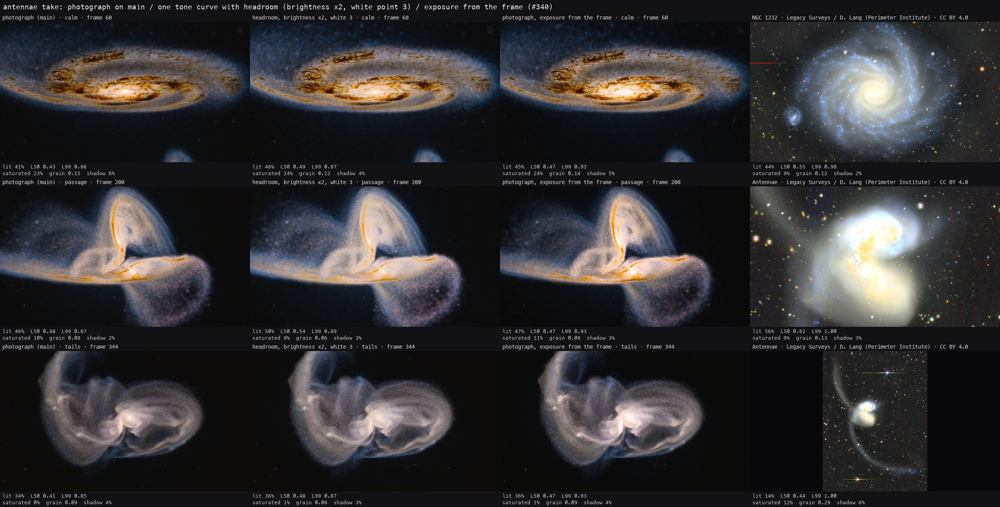

# Exposure per scene

#340, following [A frame that passes for a photograph](a-frame-that-passes-for-a-photograph.md).
`photograph` was set on the Mice take; with the same `brightness`, `stretch` and `whitePoint` the
Antennae take stopped its cores at L 0.85 to 0.87, because the three are absolute and another
scene's light lands elsewhere on the curve.

**In short.**

- A look can now take its exposure from the frames it draws: `"exposure": {"median": 0.47,
  "top": 0.93}` scales its brightness and stretch until the lit pixels' median and 99th centile
  of OKLab L, read as `scripts/photo-ruler.py` reads them, land there. `photograph` has it; no
  other look does, and a look without it draws as before, byte for byte.
- On both takes' three moments, L50 lands at 0.468 to 0.472 and L99 at 0.928 to 0.934 (before:
  0.41 to 0.48 and 0.85 to 0.94). One tone curve with headroom, tried as settings, narrows the
  top to 0.04 at best by greying every core and leaves the median spread at 0.07.
- A video is measured on seven of its frames and drawn with one exposure throughout, so it
  cannot pump. Through the Mice's first passage it moves slightly less from frame to frame than
  without.

## How it is measured

`ExposureMeter` reads a frame back as RGBA, area-averages it to 960 px wide, and takes the
ruler's numbers: the sky is the 5th centile of L blurred at 4 px, lit is 0.10 above it, and the
median and the 99th centile are those of the lit pixels. On the twelve stills below it agrees with
the ruler to 0.001.

`ExposureSolver` multiplies the look's `brightness` and `stretch` by two scales and draws the frame
again until both numbers are within 0.004 of the target: Newton's method on the logs of the scales,
the Jacobian taken by finite differences once and then corrected along each step (Broyden). The
brightness moves both numbers, the stretch mostly the median against the top, so two knobs meet
two targets. Four or five draws suffice on every moment here; a 4K still costs about 0.2 s more
per draw. A look with no stretch moves the brightness alone, for the top.

The white point stays the look's. The brightness scales the particles' light before the bloom,
so the bloom keeps its share of a core; the sky's light is added after and does not move.

## Where it applies

- **Stills** (`look --grid`, with or without `--stills`): each cell is measured on itself.
- **Videos** (`export`, previews): seven frames, the middles of seven equal stretches of the clip,
  are measured apart, and the clip is drawn with the geometric mean of their scales. `export`
  prints it, with the range the frames alone would have asked for.
- **The full pass of a hires**: measured the same way on the massive take it is framed on, at the
  first preset's size, and held for every preset. The CUDA engine draws the look's own exposure.
- **Not**: the app's canvas and thumbnails, and Auto, which copies a rendering's settings but not
  its exposure, so telescope nights draw as before.

## Two takes, three moments

The moments and cameras of the #315 note, 4K stills reduced to 960 px, the ruler's numbers
([sheets](https://github.com/pierregc/sillage/blob/a257eade4699ee56f1d6349ca1d16bc4b41937a8/mice.jpg),
[numbers](https://github.com/pierregc/sillage/blob/a257eade4699ee56f1d6349ca1d16bc4b41937a8/numbers/ruler.json)):

| Calm / passage / tails | Mice L50 | Mice L99 | Antennae L50 | Antennae L99 |
| --- | --- | --- | --- | --- |
| `photograph` on `main` | 0.42 / 0.47 / 0.41 | 0.93 / 0.91 / 0.94 | 0.43 / 0.48 / 0.41 | 0.86 / 0.87 / 0.85 |
| with the exposure | 0.47 / 0.47 / 0.47 | 0.93 / 0.93 / 0.93 | 0.47 / 0.47 / 0.47 | 0.93 / 0.93 / 0.93 |
| scales, brightness | x1.32 / x1.20 / x1.38 | | x2.16 / x1.55 / x2.44 | |
| scales, stretch | x1.56 / x0.71 / x1.93 | | x0.53 / x0.40 / x0.54 | |

The Antennae take needs twice the light and half the stretch: its disks are fainter and their
light more even. Lit and saturated shares hardly move (the Antennae's calm disk stays at 24 %
saturated: its dust, not its exposure, is what darkens it).

**A tone curve with headroom** was tried as nine settings over both takes, brightness x1.3, 1.6 and
2 with white points 2.2, 3 and 4.5. The spread over the six moments:

| | L50 | L99 |
| --- | --- | --- |
| `photograph` on `main` | 0.413-0.476 | 0.851-0.935 |
| brightness x2, white point 4.5 (narrowest top) | 0.460-0.537 | 0.849-0.890 |
| brightness x1.6, white point 2.2 | 0.444-0.520 | 0.889-0.957 |
| exposure from the frame | 0.468-0.472 | 0.928-0.934 |

A higher white point packs the tops together only by keeping every core grey, and nothing in a
single curve can move the median of one scene against another's: that is the light profile.

## A clip through a passage

The #315 clip, frames 160 to 459 of the Mice at 30 fps with one fixed camera on the pair, exported in 4K
both ways and read at 1080p
([side by side](https://github.com/pierregc/sillage/blob/a257eade4699ee56f1d6349ca1d16bc4b41937a8/passage-main-vs-exposure-1080p.mp4)).
The frame-to-frame measure is each frame's mean distance from the mean of its neighbours over the
galaxies (`tools/flicker.py` on the assets branch; its mask differs from the #315 note's, which
read 5.3 and 11.0 for the same frames):

| | whole clip | frames 161-198 | 99.9th centile there | largest step of L50 / L99 |
| --- | --- | --- | --- | --- |
| `photograph` on `main` | 5.57 | 12.39 | 98 | 0.0069 / 0.0042 |
| with the exposure | 5.26 | 11.49 | 95 | 0.0057 / 0.0034 |

The held scales were brightness x1.29 and stretch x1.39; the seven frames alone asked for x0.86 to
x1.59 and x0.93 to x1.95, so an exposure that followed each frame would have pumped through the
passage. Held, the clip's own L50 runs from 0.44 to 0.54 as the galaxies meet, as it did before
(0.41 to 0.50).

## Left as it is

- One exposure per clip: a long film from calm disks to tails keeps the differences between its
  moments. A curve eased over many seconds would follow them without pumping, if a film needs it.
- Auto does not carry the exposure into the styles it generates (#341 is about its scores).
- The app's canvas draws the look's own brightness and stretch.
