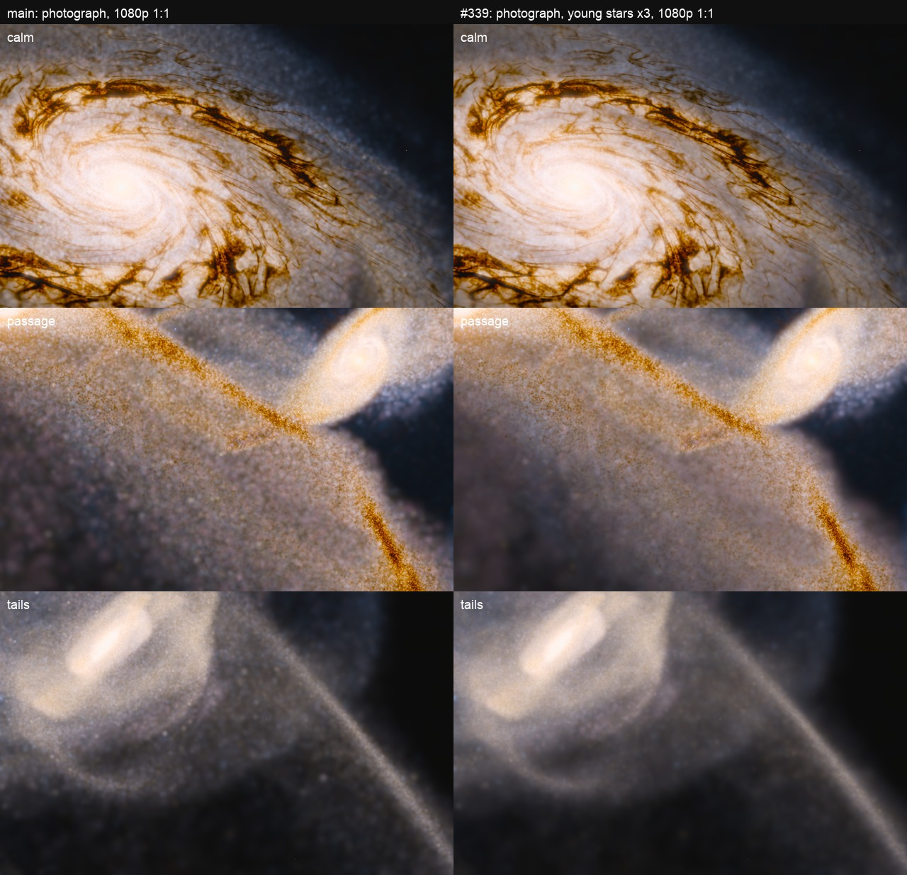

# A kernel width per population (#339)

The first follow-up of [A frame that passes for a photograph](a-frame-that-passes-for-a-photograph.md),
its step 3 done for real: the young stars drawn wider than the old ones, so that the few per cent
of them scattered through a disk stop reading as sand.

## What a look sets

Four `RenderLook` fields, each a factor on the kernel the tree and the column smoothing give a
star, 1 by default:

| Field | Slider | Population |
| --- | --- | --- |
| `oldWidth` | Old disk width | everything else that emits: the disk's old stars, the thick disk and halo |
| `bulgeWidth` | Bulge width | the bulge |
| `youngWidth` | Young star width | stars under about 300 Myr, sampled or formed by the run |
| `knotWidth` | Knot width | what gas formed under about 50 Myr: the seeded HII regions and the run's knots |

The populations come from what a take already holds, the component and the age. The age bounds
are not sharp: a star goes from one width to the next over a factor of two of its age either side
(150 to 600 Myr for the young, 25 to 100 Myr for the knots), in log age. A sampled star keeps the
age it was drawn with, but a star the run formed ages, and with a sharp bound each of the hundreds
of thousands that cross it in a film would jump from wide to narrow in one frame. The dust keeps
its kernel: grains widened with the stars are another follow-up of #315.

`sillage-render` takes them as `--old-width`, `--bulge-width`, `--young-width` and
`--knot-width`; the style editor and the panel have a slider for each under the instrument's
controls, and Reset there puts them back.

## Neutral means the same bits

The four are in the shared shader source (`populationWidth` in `Shaders`), so the CUDA engine
draws them as Metal does, but Metal compiles them only into a second library of the same text
with `SILLAGE_POPULATION_WIDTHS` defined (`Renderer.widenedSource`). The renderer draws the
stars with that library's two pipelines (massive and light tracers) only when a frame's
uniforms widen something (`SplatUniforms.widens`), and builds them the first time it does: a
full compile of `Shaders`, about a second, once a process. Everything else, and every look that
leaves the four at 1, draws with the library of `main`, whose text the preprocessor gives back
unchanged. With fast math, code that never runs still moves roundings
([gigantism.md](gigantism.md#what-was-tried) measured one level on 0.04 % of the pixels for the
column smoothing), so a uniform tested at run time would not have kept the pictures.

The CUDA engine always has the code: it builds without fast math or contraction, so a factor
of one leaves a kernel exactly as it was. `SplatUniforms` grows from 176 to 192 bytes; a dump of
targets written before reads as four widths of one (`CUDARenderChecks`).

## On the photograph look

Measured with `scripts/photo-ruler.py` at 960 px on #315's three moments of the Mice take (8 M,
calm disk, first passage, tails), from 4K stills. `photograph` now sets `youngWidth` 3 and leaves
the other three at 1; the glint stays at the style glint, 0.3, as every shipped style's.

| Mice take, calm / passage / tails | saturated | L50 | L99 | grain |
| --- | --- | --- | --- | --- |
| `photograph` on `main` | 16 / 15 / 0 % | 0.42 / 0.47 / 0.41 | 0.93 / 0.91 / 0.94 | 0.138 / 0.108 / 0.071 |
| young stars x3 (the look now) | 15 / 14 / 0 % | 0.42 / 0.47 / 0.41 | 0.92 / 0.91 / 0.93 | 0.122 / 0.086 / 0.040 |
| young x3, glint 0.6 | 15 / 14 / 0 % | 0.42 / 0.48 / 0.42 | 0.93 / 0.91 / 0.93 | 0.123 / 0.088 / 0.046 |
| young x3, knots x3 | 15 / 14 / 0 % | 0.42 / 0.48 / 0.41 | 0.92 / 0.91 / 0.93 | 0.120 / 0.080 / 0.037 |
| `photograph` without its dust | 0 / 2 / 0 % | 0.46 / 0.50 / 0.42 | 0.95 / 0.97 / 0.96 | 0.069 / 0.071 / 0.070 |
| without its dust, young x3 | 0 / 2 / 0 % | 0.46 / 0.50 / 0.42 | 0.95 / 0.97 / 0.96 | 0.039 / 0.042 / 0.039 |

- **The stars' sand is gone.** Without the dust the grain of the stars halves, 0.07 to 0.04 on
  all three moments, below #315's throwaway (0.06 to 0.07, which also had the glint at 0.6). The
  blue and white points of the passage and the tails go at 1080p, and the arms, the lanes and the
  exposure stay where they were (L50 and L99 within 0.002).
- **What is left over 0.07 is the dust**, not the stars: 0.12 on the calm disk and 0.09 at the
  passage. The lanes of the web have edges finer than a pixel, which a photograph has too, and
  the grains outside the web keep their own small kernels and stipple the passage's bridge in
  orange: #315's fifth follow-up, dust grains widened with the stars.
- **The knots** at 3 smooth a little more (0.080 at the passage), as a haze: left at 1, they stay
  the compact sources the beads of #315's second follow-up would group.

**The cost.** Sixty frames of the passage exported in 4K from the 8 M take (reading the take and
encoding included), under the GPU lock, twice each, alternated: `photograph` on `main` 22.8 and
23.3 s, young stars x3 25.4 and 27.6 s, with the glint at 0.6 25.6 and 28.5 s. About 385 ms a frame
becomes 425 to 460, 11 to 18 % more: a few per cent of the stars drawn over nine times the area.

The whole frames ([sheet-full.jpg](https://github.com/pierregc/sillage/blob/fc596fbc5ea0ded77b4859c597fa6898736b9da4/sheet-full.jpg)),
the numbers and the throwaway tooling are on the branch `assets/339-population-widths`.
